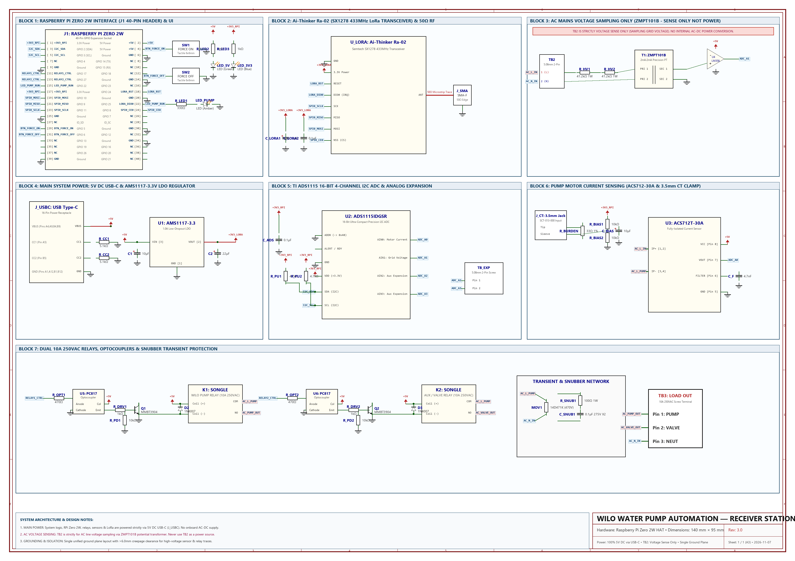
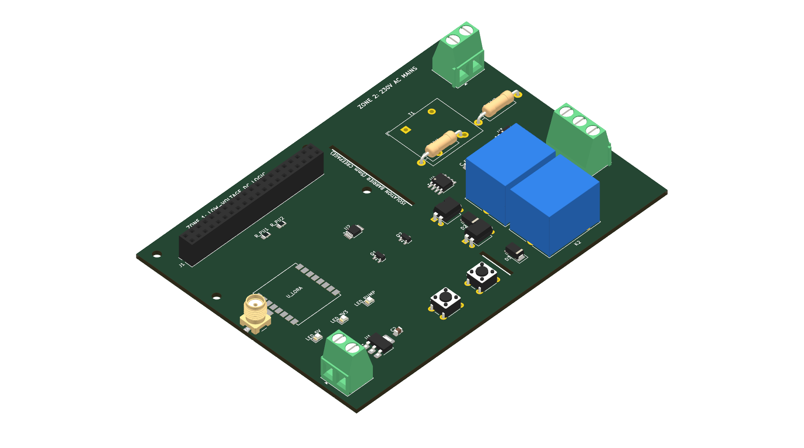
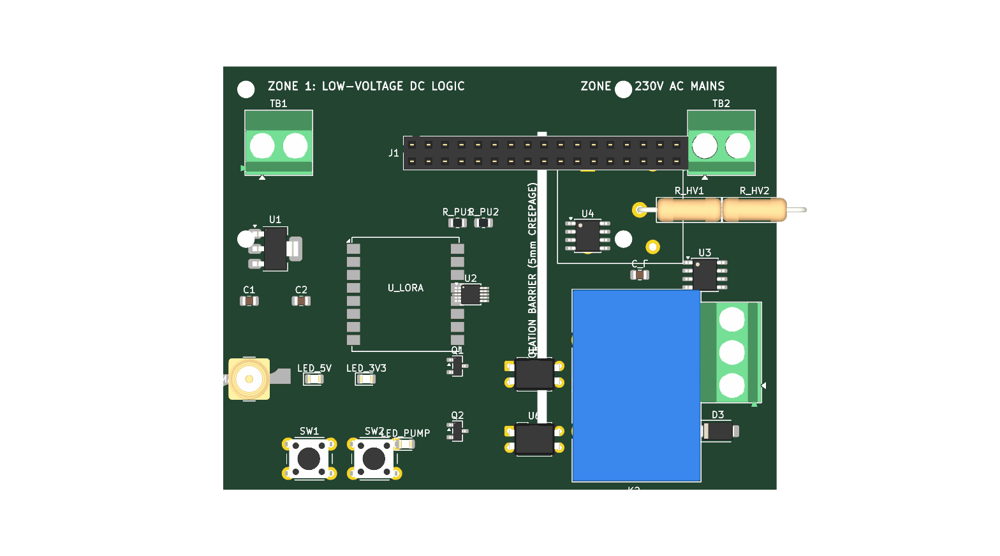

# Wilo Water Pump Automation — Receiver Station HAT (Rev 3.0)

[](https://www.kicad.org/)
[-success.svg)](#)
[](#)
[](LICENSE)

Production-ready KiCad hardware project for the **Wilo Water Pump Automation Receiver Station HAT** (Rev 3.0). This board acts as the central automation hub, pairing a **Raspberry Pi Zero 2W**, **SX1278 433 MHz LoRa transceiver**, **ADS1115 16-bit precision ADC**, **dual 10A 250VAC relays**, and **isolated AC voltage and current sensors** into an industrial-grade automation controller.

---

## Visual Showcase

### Full Engineering Schematic Diagram (Rev 3.0 — 7 Functional Blocks)


### High-Resolution 2D Board Layout (Rev 3.0 — 140 mm × 95 mm)


### 3D Raytraced Isometric View


### 3D Raytraced Top-Down View


---

## Key Hardware Architectural Features

1. **100% 5V DC USB-C Main Power**:
   - The entire board's logic, Raspberry Pi Zero 2W, LoRa transceiver, relays, and sensors are powered strictly through the **5V DC USB-C port (`J_USBC`)**.
   - **Zero internal AC-to-DC converter**: keeps the control board low-voltage, cool, and safe to service.
   - Dedicated onboard **AMS1117-3.3V LDO regulator (`U1`)** provides low-noise 3.3V power to the Ra-02 LoRa module and sensitive 3.3V analog rails.

2. **Single Unified Ground Plane Architecture**:
   - The PCB layout features an expanded **140 mm × 95 mm** footprint with a single continuous ground plane for superior signal integrity and low impedance return paths.
   - Eliminates complex slot cutouts and isolation zone boundaries while maintaining generous physical spacing (>6.0 mm clearance) around high-voltage sensor pins and relay traces.

3. **Perimeter & Corner Connector Strategy**:
   - All external terminals, headers, buttons, and jacks are strategically positioned around the board edges and corners for clean enclosure routing and panel mounting:
     - **`J_USBC` (5V Main Power)**: Bottom-left corner (`(12, 82)`).
     - **`J_SMA` (50Ω Antenna)**: Top-left edge (`(10, 30)`).
     - **`J_CT` (3.5mm Current Clamp)**: Mid-left edge (`(11.5, 54)`).
     - **`J1` (RPi Zero 2W 40-Pin Header)**: Top perimeter (`(40, 14)`).
     - **`TB_EXP` (A2/A3 Expansion)**: Top-right edge (`(98, 15)`).
     - **`TB2` (Voltage Sense Only)**: Top-right corner (`(125, 17)`).
     - **`TB3` (Load Out)**: Bottom-right corner (`(125, 76)`).
     - **`SW1` & `SW2`**: Bottom edge manual tactile override controls (`FORCE ON`, `FORCE OFF`).

4. **Sensing & Telemetry Subsystems**:
   - **Mains Voltage Sensing (`TB2`)**: `TB2: SENSE ONLY (NOT POWER)`. Samples 230V AC grid voltage across high-voltage drop resistors (`R_HV1` 41.2kΩ 1W, `R_HV2` 41.2kΩ 1W) through a **ZMPT101B potential transformer (`T1`)** and active LM358 op-amp conditioning into ADS1115 Channel A1.
   - **Motor Current Sensing**: Dual sampling capability using either an external 3.5mm split-core CT clamp (`J_CT`) into ADS1115 Channel A0, or an onboard **ACS712T-30A Hall-effect current sensor (`U3`)**.
   - **Auxiliary Inputs (`TB_EXP`)**: 2-pin screw terminal exposing ADS1115 Channels A2 & A3 for external water pressure, float switches, or temperature probes.

5. **Industrial Load Switching & Protection**:
   - **Dual 10A 250VAC Songle Relays**: `K1` (Wilo Pump) and `K2` (Auxiliary / Motorized Valve).
   - **Galvanic Optical Isolation**: Driven via **PC817 optocouplers (`U5`, `U6`)** with **MMBT3904 NPN transistors (`Q1`, `Q2`)** and flyback protection diodes (`1N4007`).
   - **Transient & Arc Suppression**: Metal Oxide Varistor (**MOV1: 14D471K**) across mains load, plus an RC snubber network (**`R_SNUB` 100Ω 1W + `C_SNUB` 0.1µF 275VAC X2 safety capacitor**).

---

## Hardware Specifications Table

| Parameter | Specification | Notes |
| :--- | :--- | :--- |
| **Board Dimensions** | 140.0 mm × 95.0 mm | 4× M2.5 mounting holes at corners |
| **Layer Count** | 2 Layers | Top: Signal & Silkscreen, Bottom: Unified GND Plane |
| **Copper Weight** | 2.0 oz (70 µm) outer layers | Rated for 10A continuous motor current handling |
| **Substrate & Thickness** | FR4 Standard, 1.6 mm | TG130-140 |
| **Main System Power** | 5V DC @ 2.5A via USB-C (`J_USBC`) | Powers RPi Zero 2W, relays, sensors, logic |
| **Onboard 3.3V Rail** | AMS1117-3.3V (1.0A max) | Low-ESR 10µF input + 22µF output tantalum/ceramic |
| **RF Transceiver** | Ai-Thinker Ra-02 (SX1278 433 MHz LoRa) | 50Ω matched trace to SMA connector (`J_SMA`) |
| **Analog-to-Digital Converter**| TI ADS1115 (16-bit 4-channel I2C ADC) | I2C address `0x48`, pull-ups 4.7kΩ to 3.3V |
| **Voltage Sensor** | ZMPT101B 2mA:2mA Current-Type PT | Isolated AC potential measurement (`TB2`) |
| **Current Sensor** | Allegro ACS712T-30A / CT clamp jack | Hall-effect isolated 66 mV/A + 3.5mm audio jack |
| **Relay Outputs** | 2× Songle SRD-05VDC-SL-C (SPDT 10A) | K1: Pump, K2: Valve/Aux |
| **Status Indicators** | 3× 0805 SMD LEDs | Green: 5V PWR, Blue: 3V3 RF, Amber: PUMP ON |
| **Manual Controls** | 2× 6×6 mm tactile push buttons | SW1: Force ON, SW2: Force OFF |

---

## Quick Start (How to Open in KiCad)

1. Clone or extract this repository to your local computer:
   ```bash
   git clone https://github.com/officialayush5839-arch/Wilo-Receiver-PCB.git
   ```
2. Launch **KiCad 7, 8, 9, or 10**.
3. Select **File → Open Project...** (`Ctrl + O`) and open **`wilo_receiver.kicad_pro`**.
4. In the KiCad Project Manager panel:
   - Double-click **`wilo_receiver.kicad_sch`** to open the modular schematic.
   - Double-click **`wilo_receiver.kicad_pcb`** to open the 140×95 mm PCB layout.
5. In the PCB Editor, press **`Alt + 3`** to view the interactive 3D raytraced model.

---

## Project Structure & Zero-Dependency Portability

```
Wilo-Receiver-PCB/
├── README.md                      # Complete project documentation with embedded graphics
├── wilo_receiver.kicad_pro        # Master KiCad project file
├── wilo_receiver.kicad_pcb        # Production 2-layer PCB layout (140 mm x 95 mm)
├── wilo_receiver.kicad_sch        # Modular schematic diagram (7 framed functional blocks)
├── wilo_receiver.kicad_sym        # Embedded symbol library definitions
├── fp-lib-table                   # Footprint table configured with ${KIPRJMOD}
├── sym-lib-table                  # Symbol table configured with ${KIPRJMOD}
├── bom.csv                        # Full Bill of Materials with references & manufacturer numbers
├── wilo_receiver.net              # Generated KiCad netlist
├── wilo_receiver.pretty/          # Local footprint directory (18 custom .kicad_mod footprints)
├── gerbers/                       # Ready-to-order manufacturing Gerbers and drill files
├── firmware/                      # Companion Raspberry Pi Python firmware & systemd service
├── wilo_receiver_schematic.png    # High-resolution engineering schematic diagram (A3)
├── wilo_receiver_board_top.png    # High-resolution 2D layout graphic
├── wilo_receiver_2d_board.svg     # Scalable Vector Graphic 2D board render
├── wilo_receiver_3d_iso.png       # 3D raytraced isometric render
└── wilo_receiver_3d_top.png       # 3D raytraced top view render
```

---

## Recommended PCB Fabrication Specs (JLCPCB / PCBWay)

- **Layers**: 2 Layers
- **Dimensions**: 140.0 mm × 95.0 mm
- **Material**: FR-4 (TG130–140)
- **Thickness**: 1.6 mm
- **Outer Copper Weight**: 2.0 oz (recommended for 10A relay load paths)
- **Surface Finish**: Lead-Free HASL or ENIG-1U
- **Solder Mask**: Pine Green (or Matte Black)
- **Silkscreen**: Crisp White (zero overlap guaranteed)
- **Min Trace / Space**: 0.25 mm / 0.25 mm (mains traces: 2.0–3.0 mm)
