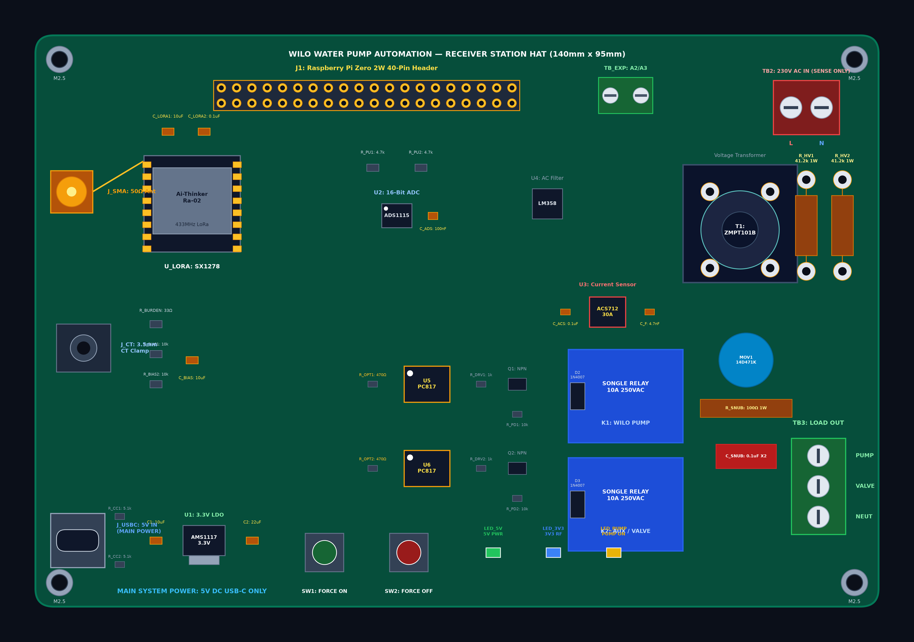

# Wilo Water Pump Automation — Receiver Station PCB (Rev 3.0)

[](https://kicad.org)
[-success.svg)](#hardware-specifications)
[](#power-architecture--unified-zone)
[](#actuator-control--protection)
[](LICENSE)

Production-ready, unified single-zone hardware design and complete KiCad project for the **Wilo Water Pump Automation Receiver Station HAT**. This board hosts the Raspberry Pi Zero 2W, Ai-Thinker Ra-02 (SX1278) LoRa radio transceiver, Texas Instruments ADS1115 16-bit ADC, Allegro ACS712 30A Hall-effect current sensor, ZMPT101B potential transformer, and dual 10A power relays with comprehensive RC snubber and MOV surge suppression.

---

## Visual Gallery

<p align="center">
  
  <br/>
  <em>Figure 1: Composite 2D PCB layout (140 mm × 95 mm) showing peripheral/corner connector placement, centralized IC layout, and single unified 5V USB-C power architecture.</em>
</p>

---

## Key Hardware Features & Architectural Highlights

- **Spacious Single-Zone Form Factor (140 mm × 95 mm)**:
  - Form factor expanded from 120×85 mm to **140 mm × 95 mm** for uncrowded trace routing, generous component clearances, and improved thermal dissipation.
  - Unified continuous ground plane powered from 5V USB-C (milled isolation slots removed as the system logic is USB-C powered).
- **Perimeter & Corner Connector Architecture**:
  - **Top Edge**:
    - `J1`: 40-Pin Raspberry Pi GPIO Header receptacle (`x0 + 55 mm, y0 + 10 mm`).
    - `TB_EXP`: 2-Pin Screw Terminal for ADS1115 Channels A2 & A3 expansion (`x0 + 98 mm, y0 + 10 mm`).
    - `TB2`: 2-Pin Screw Terminal for 230V AC mains voltage sampling only (`x0 + 128 mm, y0 + 12 mm`).
  - **Left Edge**:
    - `J_SMA`: 50 Ω SMA Edge Antenna Connector (`x0 + 6 mm, y0 + 26 mm`).
    - `J_CT`: 3.5 mm Stereo Audio Jack for SCT-013-000 CT clamp (`x0 + 8 mm, y0 + 52 mm`).
    - `J_USBC`: USB Type-C Receptacle for main 5V DC system power (`x0 + 7 mm, y0 + 84 mm`).
  - **Bottom Edge**:
    - `SW1`: Force ON Manual Push Button (`x0 + 48 mm, y0 + 86 mm`).
    - `SW2`: Force OFF Manual Push Button (`x0 + 62 mm, y0 + 86 mm`).
    - Status LEDs: `LED_5V` (Green Power), `LED_3V3` (Blue Radio), `LED_PUMP` (Yellow Pump Active).
  - **Bottom-Right Corner**:
    - `TB3`: 3-Pin Heavy-Duty Terminal Block for Actuator Loads (`PUMP`, `VALVE`, `NEUT`).
- **Logical IC Placement & Short RF Trace**:
  - `U_LORA` (SX1278) placed directly adjacent to `J_SMA` with short, controlled-impedance 50 Ω RF trace and dedicated decoupling (`C_LORA1`, `C_LORA2`).
  - `U1` (AMS1117-3.3) placed directly next to `J_USBC` with 10 µF input and 22 µF output filtering.
  - `U2` (ADS1115 16-Bit ADC) centrally positioned between Raspberry Pi I2C lines and analog sensor front-ends.
  - `U4` (LM358) and `U3` (ACS712) positioned directly adjacent to their respective sensing inputs.
- **Optically Isolated Dual 10A Relays**:
  - Driven via PC817 optocouplers (`U5`, `U6`) and MMBT3904 NPN transistors (`Q1`, `Q2`).
  - Inductive flyback suppression with 1N4007 diodes (`D2`, `D3`).
  - Inductive kickback snubber network across pump relay contacts: 14D471K MOV (`MOV1`) + RC snubber (`R_SNUB1` 100 Ω 1W + `C_SNUB1` 0.1 µF 630V X2 safety film capacitor).
- **Clean Modular KiCad Schematic**:
  - 7 cleanly partitioned, framed functional blocks with descriptive headers and clear netlabels.

---

## Hardware Specifications

| Parameter | Specification | Notes |
|---|---|---|
| **Board Dimensions** | 140.0 mm × 95.0 mm | Standard rectangular 2-layer FR4 |
| **Board Thickness** | 1.6 mm | Standard industrial PCB thickness |
| **Copper Weight** | 2.0 oz (70 µm) outer layers | **Recommended** to support 10A pump motor loads |
| **Logic Voltage** | 3.3 V DC | All Raspberry Pi GPIOs are strictly 3.3V |
| **Main Power Input** | 5.0 V DC via USB Type-C (`J_USBC`) | Powers Pi, Relays, ACS712, and AMS1117 |
| **Mains Voltage Range** | 80 V – 260 V AC (50/60 Hz) | Sampled via ZMPT101B potential transformer |
| **Motor Current Range** | 0 – 30 A AC (RMS) | Scaled for pumps up to 5.5 kW (FLA ~11.4A) |
| **Relay Contact Rating** | 10 A @ 250 V AC / 10 A @ 30 V DC | Songle SRD-05VDC-SL-C Form C |
| **RF Operating Band** | 433 MHz (Ra-02 / SX1278) | 50 Ω SMA edge connector |

---

## Perimeter Connector Layout & Pin Mapping

```
x0, y0 = 50.0, 50.0
Width  = 140.0 mm (X: 50.0 -> 190.0 mm)
Height = 95.0 mm  (Y: 50.0 -> 145.0 mm)

┌─────────────────────────────────────────────────────────────────────────────────────────────┐
│ (x0, y0)                                                                       (x0+140, y0) │
│  [J_SMA]            [J1: Raspberry Pi 2x20 Header]              [TB_EXP]             [TB2]  │
│  (Top-Left)         (Top Edge / Accessible Header)               (A2/A3)       (AC Sense In)│
│                                                                                             │
│  [U_LORA]                     [U2: ADS1115 ADC]                  [U4: LM358]        [T1]    │
│  (Ra-02 433MHz)               (Central Analog Hub)               (AC Filter)    (ZMPT101B)  │
│                                                                                             │
│  [J_CT]                       [CT Bias Network]                  [U3: ACS712]   [R_HV1/HV2] │
│  (3.5mm Jack)                 (33Ω + 10k Bias)                   (Hall Sensor)  (1W Limits) │
│                                                                                             │
│                               [Q1/Q2 Drivers &                   [K1: PUMP]     [MOV1/SNUB] │
│                                U5/U6 Optos]                      [K2: VALVE]    [TB3: LOAD] │
│                                                                                 (Bot-Right) │
│  [J_USBC]           [U1: AMS1117]       [SW1: ON]     [SW2: OFF]        [STATUS LEDS]       │
│  (Bot-Left)         (3.3V LDO Power)    (Button)      (Button)          (5V/3V3/Pump)       │
│ (x0, y0+95)                                                                 (x0+140, y0+95) │
└─────────────────────────────────────────────────────────────────────────────────────────────┘
```

### 1. External Perimeter Connectors

| Designator | Connector Type | Edge Placement | Function |
|---|---|---|---|
| **`J1`** | 2×20 2.54 mm Pin Socket | Top Edge | Direct HAT mounting to Raspberry Pi Zero 2W |
| **`TB_EXP`** | 2-Pin 5.08 mm Terminal | Top Edge | ADS1115 Expansion Channels `A2` & `A3` |
| **`TB2`** | 2-Pin 5.08 mm Terminal | Top-Right Corner | 230V AC Mains Voltage Sensing Input (`L`, `N`) |
| **`J_SMA`** | 50 Ω Coaxial SMA Jack | Top-Left Edge | 433 MHz LoRa Radio Antenna |
| **`J_CT`** | 3.5 mm Stereo Audio Jack | Mid-Left Edge | SCT-013-000 Non-Invasive Current Clamp |
| **`J_USBC`** | USB Type-C Receptacle | Bottom-Left Corner | 5V DC Main Power Supply Input |
| **`SW1`** | 6 mm Tactile Push Button | Bottom Edge | Manual Force PUMP ON (`GPIO22`) |
| **`SW2`** | 6 mm Tactile Push Button | Bottom Edge | Manual Force PUMP OFF (`GPIO5`) |
| **`TB3`** | 3-Pin 5.08 mm Terminal | Bottom-Right Corner | Switched Actuators Output (`PUMP`, `VALVE`, `NEUT`) |

---

## 7 Clean Modular Schematic Blocks (`wilo_receiver.kicad_sch`)

When opening `wilo_receiver.kicad_sch` in the KiCad Schematic Editor, the circuit is framed into 7 functional sections:

1. **HOST RASPBERRY PI ZERO 2W INTERFACE & GPIO BUS**:
   - 40-Pin header `J1`, `SW1` (Force ON), `SW2` (Force OFF), `LED_5V`, `LED_3V3`, `LED_PUMP` with series current-limiting resistors.
2. **SX1278 Ra-02 LoRa 433MHz TRANSCEIVER & RF**:
   - `U_LORA` module, decoupling capacitors `C_LORA1` (10 µF) and `C_LORA2` (100 nF), 50 Ω SMA connector `J_SMA`.
3. **AC MAINS VOLTAGE SAMPLING (ZMPT101B)**:
   - High-voltage terminal `TB2`, dual 41.2 kΩ 1W metal film resistors `R_HV1`/`R_HV2`, micro potential transformer `T1`, and `U4` LM358 signal conditioner.
4. **5V DC USB-C POWER SUPPLY & 3.3V LDO**:
   - `J_USBC` receptacle, 5.1 kΩ CC resistors `R_CC1`/`R_CC2`, `C1` input capacitor, `U1` AMS1117-3.3, and `C2` output capacitor.
5. **ADS1115 16-BIT ADC & EXPANSION**:
   - `U2` ADS1115 I2C ADC, `C_ADS` decoupling cap, 4.7 kΩ I2C pull-ups `R_PU1`/`R_PU2`, and expansion terminal `TB_EXP`.
6. **MOTOR CURRENT SENSING (ACS712 & CT CLAMP)**:
   - `J_CT` 3.5 mm jack, `R_BURDEN` 33 Ω burden resistor, `R_BIAS1`/`R_BIAS2`/`C_BIAS` DC bias network, `U3` ACS712T-30A current sensor, and `C_F`/`C_ACS` filter caps.
7. **DUAL POWER RELAYS, OPTOCOUPLERS & SNUBBER TRANSIENT PROTECTION**:
   - PC817 optocouplers `U5`/`U6`, MMBT3904 drivers `Q1`/`Q2`, flyback diodes `D2`/`D3`, power relays `K1`/`K2`, 14D471K MOV `MOV1`, RC snubber `R_SNUB1`/`C_SNUB1`, and actuator load terminal `TB3`.

---

## Bill of Materials (Summary)

The complete Bill of Materials is generated in `bom.csv`:

| Item | Qty | Reference | Value / Part | Footprint | Function |
|---|---|---|---|---|---|
| 1 | 1 | `J1` | RPi GPIO Header | PinSocket_2x20_P2.54mm_Vertical | 40-pin Raspberry Pi HAT interface |
| 2 | 1 | `J_USBC` | USB Type-C | HRO_TYPE-C-31-M-12 | 5V DC Main Power Supply |
| 3 | 1 | `U_LORA` | Ra-02 SX1278 | Ai-Thinker-Ra-01-LoRa | 433 MHz LoRa transceiver |
| 4 | 1 | `J_SMA` | 50Ω Jack | SMA_Amphenol_132134-10 | LoRa antenna connection |
| 5 | 1 | `U1` | AMS1117-3.3 | SOT-223-3_TabPin2 | Dedicated 3.3V 1A LDO regulator |
| 6 | 1 | `U2` | ADS1115IDGSR | MSOP-10_3x3mm_P0.5mm | 16-bit 4-channel I2C ADC |
| 7 | 1 | `U3` | ACS712T-30A | SOIC-8_3.9x4.9mm_P1.27mm | 30A AC Hall-effect current sensor |
| 8 | 1 | `U4` | LM358 | SOIC-8_3.9x4.9mm_P1.27mm | Voltage sensor op-amp filter |
| 9 | 1 | `T1` | ZMPT101B | Transformer_Zeming_ZMPT101K | Precision AC potential transformer |
| 10 | 2 | `K1`, `K2` | SRD-05VDC-SL-C | Relay_SPDT_SANYOU_SRD | 10A 250VAC power relays |
| 11 | 2 | `U5`, `U6` | PC817 | DIP-4_W7.62mm | Galvanic optocouplers |
| 12 | 2 | `Q1`, `Q2` | MMBT3904 | SOT-23 | NPN relay drivers |
| 13 | 1 | `MOV1` | 14D471K | Disc_D12mm_W4.2mm_P7.5mm | Inductive transient surge suppressor |
| 14 | 1 | `R_SNUB1` | 100Ω 1W | Axial_DIN0411_L9.9mm_P15.24mm | RC snubber resistor |
| 15 | 1 | `C_SNUB1` | 0.1µF 630V X2 | Rect_L10.0mm_W4.0mm_P7.50mm | RC snubber safety capacitor |
| 16 | 2 | `R_HV1`, `R_HV2` | 41.2k 1W | Axial_DIN0411_L9.9mm_P15.24mm | Voltage divider limiting resistors |
| 17 | 1 | `J_CT` | SCT-013-000 | Audio_Jack_3.5mm_Horizontal | CT clamp 3.5mm input |
| 18 | 2 | `SW1`, `SW2` | SW_Push | Button_Switch_THT_SW_PUSH_6mm | Force ON / Force OFF buttons |
| 19 | 2 | `TB_EXP`, `TB2` | MKDS-1,5/2-5.08 | Phoenix_MKDS-1,5-2-5.08mm | 2-pin screw terminals |
| 20 | 1 | `TB3` | MKDS-1,5/3-5.08 | Phoenix_MKDS-1,5-3-5.08mm | 3-pin actuator load terminal |
| 21 | 3 | `LED_5V`, `LED_3V3`, `LED_PUMP` | LEDs 0805 | LED_0805_2012Metric | Status indicators |

---

## KiCad Project Quickstart

1. Download the distribution package:
   - File: `wilo_receiver_kicad_pcb.zip`
2. Extract the archive.
3. Open `wilo_receiver.kicad_pro` directly in **KiCad 7, 8, 9, or 10**:
   - Double-click `wilo_receiver.kicad_sch` to view the 7 structured schematic blocks.
   - Double-click `wilo_receiver.kicad_pcb` to view the uncrowded 140 mm × 95 mm board layout.
   - Press <kbd>Alt</kbd> + <kbd>3</kbd> in PCB Editor to open the 3D Viewer.
